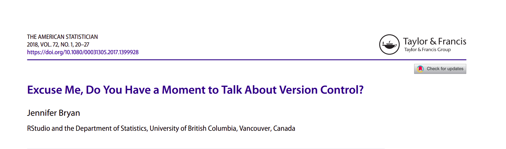
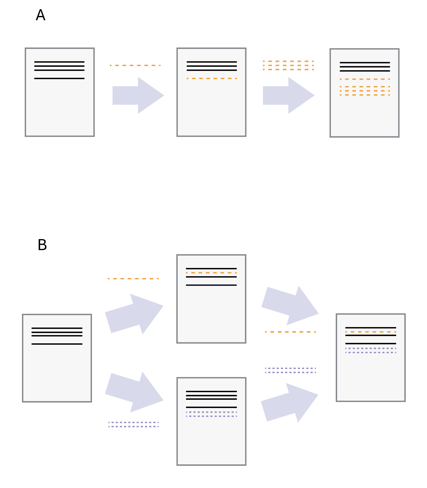
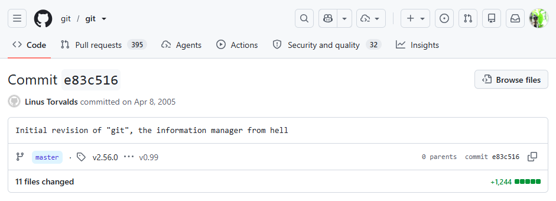
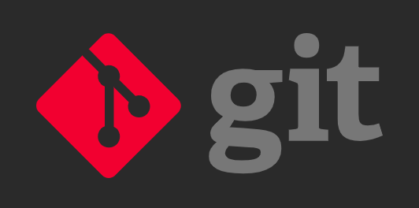
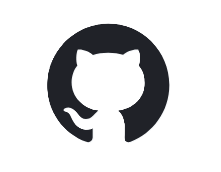

\

------------------------------------------------------------------------

## Learning objectives

- understand the benefits of version control
- know where to find help when setting up Git and GitHub on your computer
- understand the concept of: `stage` (`add`), `commit`, `push`, `pull`, `clone`
- work with GitHub repositories from the command line, RStudio, Visual Studio Code, Positron... (wherever you do your coding)

------------------------------------------------------------------------

## Version control - What is it?

{.absolute top="100" left="0"} [Sources: [PhD Comics "Final.doc"](https://phdcomics.com/comics/archive.php?comicid=1531), @swcarpentry_gitnovice]

{.absolute top="100" right="115" width="700"}

------------------------------------------------------------------------

## What is git?



- fast
- optimal for non-linear workflows
- strong safeguards against file corruption

------------------------------------------------------------------------

## Git or GitHub?

:::::: columns
::::: r-fit-text
::: {.column width="50%"}
### Git

{height="100"}

- local software (offline)
- tracks file changes
- needs to be installed (it's free)
- works natively in the terminal
:::

::: {.column width="50%"}
### GitHub

{height="100"}

- Remote code hosting and collaboration platform (owned by Microsoft)
- Common alternatives: Bitbucket and GitLab (some instances are self-hosted by universities)
- Additional features include collaboration, project management, publishing, and Actions
- Free account required
- Works via the web, terminal, and GUI clients (such as GitHub Desktop)
:::
:::::
::::::

------------------------------------------------------------------------

## We all know the problem

![[@Bryan2018]](img/Bryan2018_Fig1.png){fig-align="center"}

[The moment when two (or more) coauthors send you their own version of the manuscript with tracked changes and you have to figure out how to combine it all
... ]{.large-text}

[**???**]{.large-text}


------------------------------------------------------------------------

## Git: three main concepts

1.  **Snapshot**: save a meaningful state of your project.
2.  **Compare**: see exactly what changed, and when.
3.  **Recover**: return to a known-good state when an experiment goes sideways.

**Git is not a backup folder.** It is a timeline of deliberate project snapshots.

------------------------------------------------------------------------

## Vocabulary[^3]

[^3]: @gotelli_github2025

::: r-fit-text
`Version Control` A system for maintaining current and past copies of all of your files and a record of all the changes you have made;

`git` Version control software for tracking your project on your local computer

`GitHub` A free, public remote website where your project is permanently hosted

`Repository` Any collection of files that belong to the same project, plus a few special git files that set up the version control. Also called a repo by hipster programmers.

`Clone` Create a local copy of a repository from the GitHub website to your own website. You can clone from your own repository or anyone else’s that is posted on GitHub. Once the files are on your local computer you can edit or use them as you like. However, you can only change files on GitHub for the repositories that you yourself created or for projects that you have been invited to collaborate on with others.

`Commit (the noun)` A snapshot of your file system at a particular time. Since your last commit, it keeps track of the files you currently have, the ones you have deleted or added, and any changes you have made to files.

`Commit (the verb)` When you commit, you are taking a snapshot of your files at the current time. You must add a summary of the commit that briefly describes what changes you have made (such as “add new homework file”). Note that all commits affect only the local copy of your repository. They do not affect the remote copy that is stored on GitHub

`Push` Pushing a set of changes means copying them from your local repository up to GitHub.

`Pull(=fetch)` Pulling means copying the repository in its current state on GitHub down to your local repository. This would incorporate any changes that others have made (and pushed) in a collaborative project.
:::

------------------------------------------------------------------------

## Git is language-agnostic

Git does not care whether the file is Python, R, Bash, Markdown, or a dataset.

``` text
project/
├── analysis.py
├── model.R
├── run.sh
├── report.qmd
└── data/
    └── observations.csv
```

Git tracks **files and their history**. Your Python environment, R packages, and shell are separate concerns that we can record alongside the code.

------------------------------------------------------------------------

## Three places where a change can live

| Place | Meaning | Git command |
|------------------------|------------------------|------------------------|
| **Working folder** | Your files right now. You can edit, run, and inspect them. | `git status` , `git diff` |
| **Staging area** | A review basket: the exact changes you want in the next snapshot. | `git add` |
| **Repository** | The saved timeline of snapshots, called commits. | `git commit` |

------------------------------------------------------------------------

## Benefits[^1] of web-hosting on GitHub, GitLab, Bitbucket, or similar

[^1]: @Bryan2018

::: r-fit-text
- Organizing, recording, and disseminating your work - Exposure prevents neglecting these tasks

- Structured collaboration and access to powerful tools for asynchronous work

- create your own web site in 60 seconds

- can be turned into citable content (add CITATION.txt file or connect to Zenodo and get a DOI)

- acts as sharable lab notebook for computational work
:::

------------------------------------------------------------------------

## Setting up git and/or GitHub

This step is always very painful. **Brace yourself!!**

I've collated information from multiple sources[^2] to make it as painless as possible.

[^2]: @ssoqe_versioncontrol, @naturhistoriska_gitgithubintro, @gotelli_github2025, @Bryan2018, @rodrigues_git2024, @posit_versioncontrol, @bryan_happygit, and @swcarpentry_gitnovice

You will be able to see and download the setup instructions as a PDF from here.

------------------------------------------------------------------------

## Workflows in Git(Hub)

After initializing a folder as a git repository (`git init` or ``git clone``)

1.  Create files, make changes
2.  `git status`
3.  stage changes: `git add -A`
4.  commit to make a snapshot: `git commit -am "Commit Message"` \
[**Do this frequently!**]{.accent}
5.  `git status`
6.  Upload commits to GitHub: `git push`
7.  Download latest version from GitHub: `git pull`
8.  `git status` \
**repeat #1-8**

------------------------------------------------------------------------

## Which files to track?

Depends on your aims. Usually:

**Track:**

- source files (files that are created and edited by hand: scripts, raw data, metadata)
- derived products with external value (e.g., figures, tables, reports)
- configuration files (e.g., .Rproj, .gitignore)

**Ignore:**

- intermediates (e.g. log files, temporary files generated from source files)

------------------------------------------------------------------------

## References

::: {#refs}
:::
